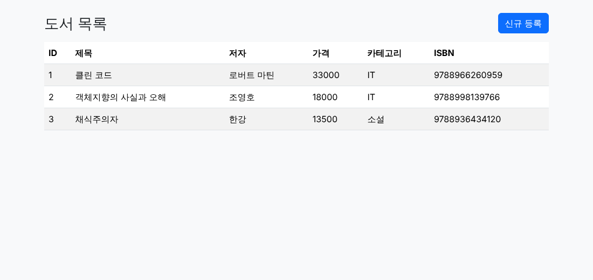
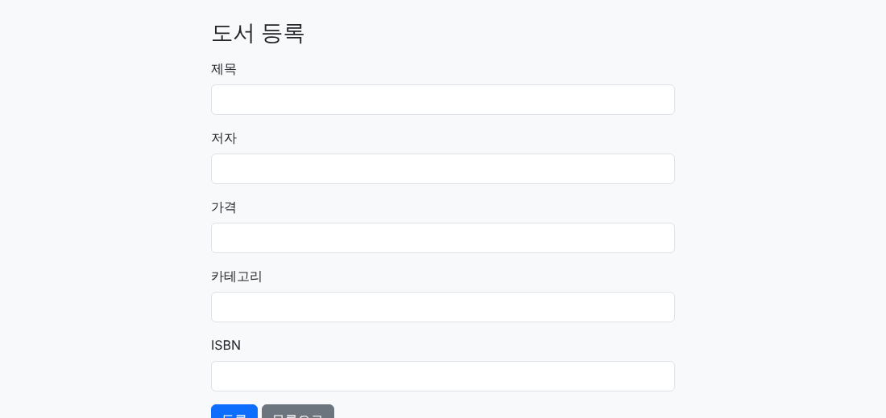

# 웹 서비스 개발 6주차 과제 - Book 관리 Web UI (Spring Boot + Thymeleaf)

## 1. 프로젝트 소개

### 프로젝트 주제
- Spring Boot **Memory 기반 CRUD**(4주차)를 확장하여 **Thymeleaf Web UI + HTML Form**으로 Book을 조회/등록
- DB 없이 `Map<Long, Book>`(Java Collection)을 저장소로 사용
- Bootstrap 5로 반응형 UI 적용

### Render 배포 URL
- 배포 URL: `TODO: https://<service-name>.onrender.com/books`

### 관리 데이터 (`Book`)

| 필드 | 타입 | 설명 | 예시 |
| :--- | :--- | :--- | :--- |
| `id` | `Long` | 자동 증가 식별자 | `1` |
| `title` | `String` | 제목 | `클린 코드` |
| `author` | `String` | 저자 | `로버트 마틴` |
| `price` | `int` | 가격(원) | `33000` |
| `category` | `String` | 카테고리 | `IT` |
| `isbn` | `String` | ISBN | `9788966260959` |

### 프로젝트 구조
```text
src/main
├── java/com/ysh/sb_curd_webui
│   ├── SbCurdWebuiApplication.java
│   ├── controller/BookWebController.java       # Web 요청 처리, View 이름 반환
│   ├── service/BookService.java                # 비즈니스 로직, DTO 변환
│   ├── repository/BookRepository.java          # Repository interface
│   ├── repository/MemoryBookRepository.java    # Map<Long, Book> 저장소
│   ├── domain/Book.java
│   └── dto/BookRequest.java, BookResponse.java
└── resources
    ├── templates/books/list.html, form.html    # Thymeleaf
    └── static/css/style.css
```

### 실행 방법
```bash
# JDK 17 이상 필요
./gradlew bootRun
# 브라우저에서 http://localhost:8080/books 접속
```

### Web Endpoint

| HTTP Method | URL | 기능 |
| :--- | :--- | :--- |
| GET | `/books` | 전체 목록 |
| GET | `/books/new` | 등록 Form |
| POST | `/books` | 데이터 등록 후 `redirect:/books` |

### 주요 화면

| 목록 (`GET /books`) | 등록 Form (`GET /books/new`) |
| :---: | :---: |
|  |  |

---

## 2. 이번 과제 키워드
`@Controller` · `Thymeleaf` · `Model` · `@ModelAttribute` · `HTML Form` · `redirect:` · `PRG Pattern` · `Bootstrap` · `Layered Architecture`

## 3. 핵심 내용 정리
1. **@Controller vs @RestController**: `@RestController`는 반환값을 HTTP Body(JSON)로 쓰고, `@Controller`는 반환 문자열을 **View 이름**으로 해석해 `templates/`의 HTML을 렌더링한다.
2. **Model → View 전달**: `model.addAttribute("books", ...)`로 담은 데이터를 Thymeleaf가 `${books}`로 읽는다.
3. **Collection 출력**: `th:each="book : ${books}"`, `th:text="${book.title}"`로 목록을 반복 출력한다.
4. **Form → DTO 바인딩**: `<input name="title">`의 name과 `BookRequest`의 필드명이 같으면 `@ModelAttribute`가 자동으로 값을 채운다.
5. **PRG**: POST 처리 후 `redirect:/books`로 GET 요청을 다시 보내 새로고침 시 중복 등록을 막는다.

---

## 4. Weekly Report

### Key Learning
1. `@Controller` + `Model` + Thymeleaf로 서버 데이터를 HTML로 렌더링하는 흐름
2. HTML Form의 `name` ↔ DTO 필드명 일치로 `@ModelAttribute` 바인딩이 이루어진다는 점
3. POST 후 redirect(PRG)로 중복 제출을 방지하는 방식

### Web UI Flow
```text
Browser → GET /books → BookWebController → BookService → BookRepository
→ MemoryBookRepository(Map) → List<BookResponse> → Model("books") → Thymeleaf → list.html
```

### Form Flow
```text
HTML Form(POST /books) → BookWebController(@ModelAttribute BookRequest) → BookService
→ BookRepository → MemoryBookRepository → redirect:/books → GET /books → list.html
```

### Problem & Solution
- **문제**: 5주차 REST 코드를 그대로 가져오니 `BookController`에 `@GetMapping`(경로 없음)이 2개 있어 `Ambiguous mapping` 오류 위험이 있었고, `@Controller`에서 `List`를 반환하면 JSON이 아니라 View 이름으로 해석되는 문제가 있었다.
- **해결**: REST용 `BookController`를 제거하고, View 이름을 반환하는 `BookWebController`를 새로 만들어 `GET /books`, `GET /books/new`, `POST /books`만 담당하게 분리했다. Service/Repository는 4주차 구조를 유지하고 `category`, `isbn` 필드만 추가했다.

### Code Review
```java
@PostMapping("/books")
public String create(@ModelAttribute BookRequest request) {
    bookService.create(request);
    return "redirect:/books";
}
```
- Form 바인딩(`@ModelAttribute`)과 PRG(`redirect:`)가 한 메서드에 모여 있어 이번 주 핵심 개념을 가장 잘 보여준다. `redirect:` 대신 View를 직접 반환하면 새로고침 시 같은 POST가 재전송되어 중복 등록된다.

### AI Usage
- **AI 활용**: Bootstrap 5 화면(list/form) 초안, README 초안 작성에 AI(Claude)를 사용했다.
- **직접 확인/수정**: URL(`/books`, `/books/new`), HTTP Method(GET/POST), `th:action="@{/books}"`, input `name` ↔ `BookRequest` 필드명, Model 변수명 `books`, Thymeleaf 문법(`th:each`, `th:text`, `th:href`)이 Controller와 일치하는지 확인했고, `curl`로 POST → 302 `Location: /books` → 목록 반영까지 검증했다.

### Reflection
- `TODO: 새롭게 알게 된 점 또는 궁금한 점 1가지를 직접 작성`

### 건의사항
- `TODO`
